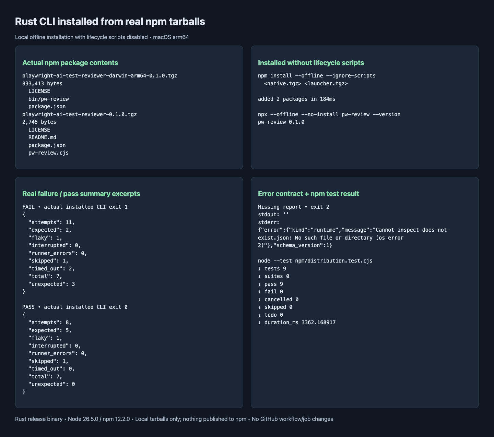
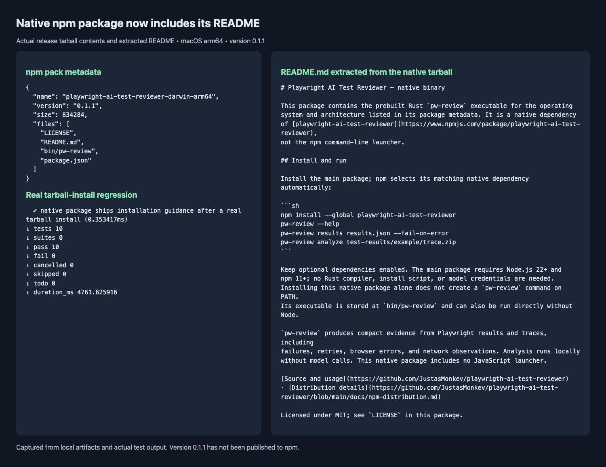

# npm distribution

The CLI stays Rust. npm adds a small Node launcher and exact-version native optional packages. There is no install script, network downloader, compiler on the consumer machine, or GitHub release workflow. Nothing is published by staging or packing.

## Consumer requirements

Use Node.js 22+ and npm 11+. The launcher uses Node built-ins only. The packaging suite is separate from `cargo test` and needs npm. Local validation currently uses Node 26.5.0 and npm 12.2.0; Node 22 has not been exercised here.

The staging tool accepts these targets:

| Rust target | Native package suffix | npm filters |
| --- | --- | --- |
| `aarch64-apple-darwin` | `darwin-arm64` | darwin / arm64 |
| `x86_64-apple-darwin` | `darwin-x64` | darwin / x64 |
| `aarch64-unknown-linux-gnu` | `linux-arm64-gnu` | linux / arm64 / glibc |
| `x86_64-unknown-linux-gnu` | `linux-x64-gnu` | linux / x64 / glibc |

The package prefix is `playwright-ai-test-reviewer`. This table describes accepted build inputs, not a claim that binaries exist for every target. A staged release advertises **only the targets supplied to that invocation**. Windows and musl Linux are unsupported. Linux builds require the glibc version and shared libraries used by their build environment; build on the oldest glibc environment you intend to support and test on it. macOS builds likewise need testing against the intended deployment baseline. No universal minimum OS or glibc version is promised by the manifest.

Once a release is published, install it with:

```sh
npm install --save-dev --save-exact playwright-ai-test-reviewer
npx --no-install pw-review --help
```

Keep optional dependencies enabled. `--ignore-scripts` is supported; `--omit=optional` leaves the launcher without its binary. The launcher reports unsupported platforms, missing packages, mismatched versions, and spawn errors as JSON on stderr with exit 2. Analysis reports and native 0/1/2 exits pass through unchanged. SIGINT, SIGTERM, and SIGHUP are forwarded; the wrapper waits for the native process and preserves signal termination.

## Stage a host-only release

Version, description, repository, and license come from Cargo package metadata. There are no hand-maintained npm manifests to synchronize. Run from the repository root. On an arm64 Mac:

```sh
cargo build --locked --release --bin pw-review
cargo run --locked --example npm-stage -- target/npm-stage \
  aarch64-apple-darwin=target/release/pw-review
mkdir -p target/npm-tarballs
npm pack ./target/npm-stage/playwright-ai-test-reviewer-darwin-arm64 \
  --ignore-scripts --pack-destination ./target/npm-tarballs
npm pack ./target/npm-stage/playwright-ai-test-reviewer \
  --ignore-scripts --pack-destination ./target/npm-tarballs
```

Use the matching target from the table on another host. The output directory must not already exist; staging never overwrites it. Remove or choose a new staging directory for another attempt. Input errors are checked before output creation. A write failure removes the newly-created incomplete directory.

The stager requires a regular native executable with a matching 64-bit Mach-O or ELF header. It runs a host binary's `--version` and rejects a version different from Cargo. Cross-target executables cannot be run by the stager: verify `pw-review --version` on the target host before staging and verify every packed binary again before publishing. Header validation does not prove a binary's provenance or runtime compatibility. Supply only your own trusted build outputs.

Only allowlisted launcher/readme/license files enter the main package; native packages contain the executable, a native-package README, and license. Source, fixtures, development tests, build tooling, and evidence are excluded. Generated directories and tarballs stay under ignored `target/`; never commit binaries.

## Offline tarball installation

A main tarball alone cannot resolve unpublished native optional packages. Install both matching tarballs together. Replace `REPO` with the absolute repository path and `0.1.0` with the Cargo version:

```sh
mkdir -p '/tmp/pw review consumer'
cd '/tmp/pw review consumer'
npm init -y
npm install --offline --ignore-scripts --no-audit --no-fund \
  'REPO/target/npm-tarballs/playwright-ai-test-reviewer-darwin-arm64-0.1.0.tgz' \
  'REPO/target/npm-tarballs/playwright-ai-test-reviewer-0.1.0.tgz'
npx --offline --no-install pw-review --help
```

For an existing project, the same install adds the packages to its manifest. In registry releases, npm selects the matching native optional dependency automatically. Tarball installation is the local verification path, not a claim that the registry already contains a release.

## Add targets and publish manually

Build each binary for its actual target, using a suitable target toolchain and linker. For example, a configured Linux x64 builder can run:

```sh
cargo build --locked --release --bin pw-review --target x86_64-unknown-linux-gnu
```

Collect those binaries on the staging machine. Pass every built target in **one** invocation, for example:

```sh
cargo run --locked --example npm-stage -- target/npm-release \
  aarch64-apple-darwin=target/release/pw-review \
  x86_64-unknown-linux-gnu=/path/to/linux-x64/pw-review
```

Do not relabel host binaries or add dependencies for builds you do not have. Pack each generated native directory and the main directory as above. Inspect `npm pack --dry-run --json` output and test each native tarball on its supported host, including CLI exit codes and signal cancellation. Check the registry names are available to your npm account; source package names do not grant ownership.

When intentionally releasing, publish **all native tarballs first**, at the exact Cargo version, then the main tarball last:

```sh
npm publish /path/to/native-package-VERSION.tgz --access public
npm publish /path/to/playwright-ai-test-reviewer-VERSION.tgz --access public
```

Repeat the first command for every optional package listed by the main manifest. Verify each exact native version is retrievable before publishing the main package. npm versions are immutable: change the Cargo version for the next release, rebuild binaries, and stage into a new directory. Never publish a main manifest whose dependencies are unavailable. Staging and test commands do not publish anything, and no workflow file is involved.

## Rerunnable validation

```sh
cargo build --locked --bin pw-review --example npm-stage
node --test npm/distribution.test.cjs
```

The suite uses the debug binaries from the preceding build (or `CARGO_TARGET_DIR`), creates a fresh staging directory with spaces, packs actual tarballs, installs them offline with scripts disabled and an empty cache, and runs the installed command plus offline `npx`. It compares native and installed output/exit contracts for pass/fail/invalid inputs and prompt/pretty options. It also exercises manifest contents, missing and mismatched native packages, unsupported hosts, staging errors/nonoverwrite, and process cancellation. It never contacts the registry or publishes packages. Cargo-only checks remain unchanged.

## Recorded installation evidence

The following capture records version 0.1.0, before native packages included a README.



The image captures a macOS arm64 release build installed into a fresh directory
whose path contains spaces, with an empty npm cache, `--offline`, and
`--ignore-scripts`. The launcher tarball was **2,745 bytes**; the native tarball
was **833,413 bytes**. These sizes describe this build, not other targets.
Installed `npx --offline --no-install pw-review --version` returned `pw-review 0.1.0`.
The real Playwright failure/pass fixtures retained **3 / 0 unexpected outcomes**
and exits **1 / 0**; missing input returned JSON stderr, empty stdout, and exit **2**.

All **9 npm tests** and **118 Rust tests** passed, along with formatting, Clippy
with warnings denied, release build, and the JS slop checker. Each npm suite run
packs and installs real tarballs and tests process cancellation. No GitHub
workflow or job was added or modified. No npm package was published. Native
package availability and execution on additional targets remain release checks.

## Native README correction in 0.1.1

Version 0.1.0 omitted the native README. Version 0.1.1 includes a dedicated
`README.md` in every native package with installation guidance and an explanation
of its relationship to the launcher. Both packages retain the same Cargo version.



The new regression first failed on the missing packed file and installed README,
then passed after the fix. All **10 npm tests** and **118 Rust tests** pass;
formatting, Clippy, release build, and JS slop-check also pass. The image shows
the README extracted from the actual macOS arm64 release tarball. Version 0.1.1
was staged and packed locally, not published. Updating the npm package page
requires publishing the new native version, then the matching launcher version.
