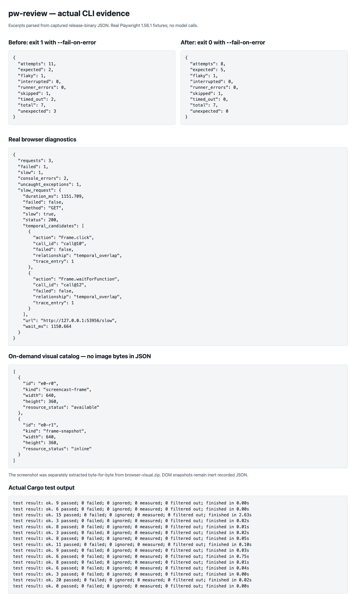
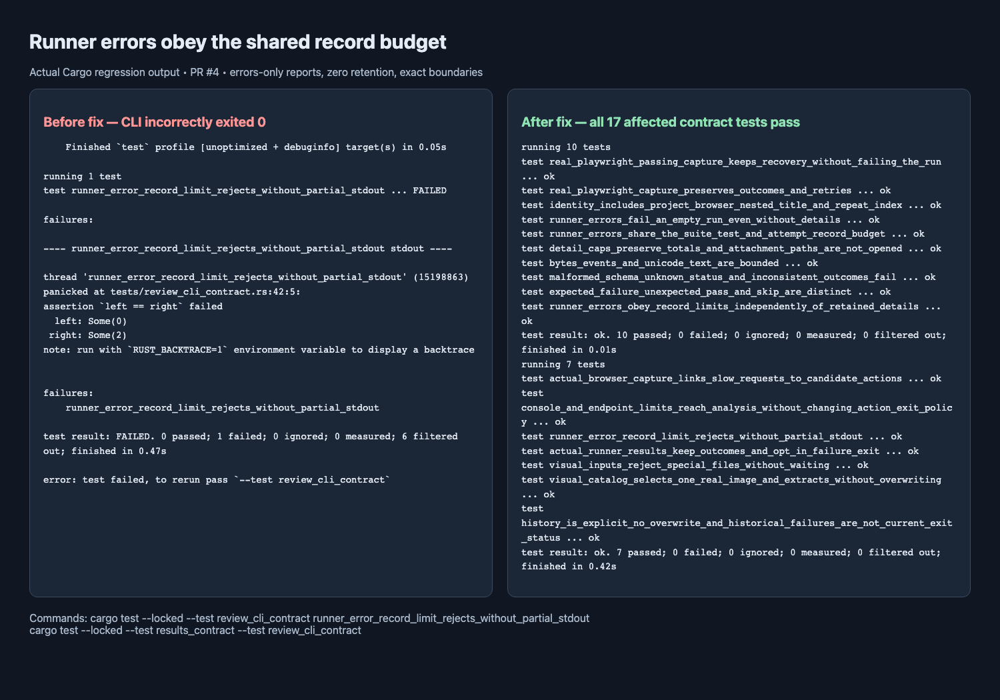

# Complete test-review validation

Validated on macOS arm64 with Rust/Cargo 1.97.0. The shipped repository remains
Rust/Cargo-only; fixture capture and evidence rendering used external temporary
Playwright 1.56.1 scripts, not repository runtime dependencies.

## Checks and behavior

Formatting, Clippy (`--locked --all-targets -- -D warnings`), all **118 Rust tests**,
and the locked release build pass locally. Every maintained file is at most 482
physical lines. The existing workflow runs these Cargo gates on Linux and macOS.

| Capability | Rerunnable contracts |
| --- | --- |
| Actual runner outcomes, expected failures, retries, interrupted attempts, invalid input and caps | `tests/results_contract.rs` |
| Explicit history, commit-aware observations, duplicate/concurrent IDs, corruption, limits, symlink/FIFO rejection | `tests/history_contract.rs` |
| Console errors, nested browser exceptions, exact endpoints, unknown durations, comparison samples and shared caps | `tests/diagnostics_contract.rs` |
| Page/stream/clock qualification, invalid intervals, bounded candidate retention | `tests/temporal_boundaries.rs` |
| Real screenshot/DOM catalog and exact extraction, malformed archives, missing resources, no overwrite or symlink traversal | `tests/evidence_contract.rs` |
| Public CLI flags, exit semantics, actual failure/pass runs, history, extraction and real network/action correlation | `tests/review_cli_contract.rs` |

The original trace/CLI/GitHub contracts also pass. Review exposed and corrected
four boundary issues: inconsistent history write/read event counting, a history
pathname check/open race, DOM viewport dimensions omitted from the catalog, and a blocking open of named-pipe visual inputs.
Regressions now check the shared exact limit, opened-file policy, and recorded
640 × 360 DOM dimensions. The visual-input regression first failed after detecting and terminating a blocked child process, then passed for both list and extract after a nonblocking Unix open plus opened-descriptor regular-file validation.



## Runner-error record-limit regression

Runner errors now consume the same `max_events` budget as suites, specs, tests,
and attempts, even when `--max-failures 0` discards every retained error detail.
The new tests failed before the fix: an errors-only report at a zero-record cap
incorrectly exited 0 instead of 2. After the fix, all 17 results/CLI contract tests
pass. Coverage includes empty zero-cap input, exact and exceeded boundaries,
shared suite/attempt budgets, retained-detail independence, and no partial stdout
on rejection. Rerun with:

```sh
cargo test --locked --test results_contract --test review_cli_contract
```



The earlier workflow image records the 115-test feature checkpoint; the full suite
now passes 118 tests. The six mutation challenges below belong to that earlier
feature checkpoint and were not rerun for this record-budget correction.

## Actual failure and pass

```sh
pw-review results tests/fixtures/results-playwright-1.56.json --fail-on-error
pw-review results tests/fixtures/results-playwright-1.56-pass.json --fail-on-error
```

| Actual capture | Tests / attempts | Expected | Unexpected | Flaky | Skipped | CLI exit |
| --- | --- | --- | --- | --- | --- | --- |
| Before fixes | 7 / 11 | 2 | 3 | 1 | 1 | 1 |
| After fixes | 7 / 8 | 5 | 0 | 1 | 1 | 0 |

These came from two real Playwright reporter runs, not edited expected outcomes.
The passing run still exposes its retry recovery and skip. Full compact outputs:
[failure](evidence/results-failure.json), [pass](evidence/results-pass.json).
Capture and minimization provenance is in [the fixture notes](../tests/fixtures/README.md).

## Actual browser diagnostics and visual extraction

```sh
pw-review analyze tests/fixtures/browser-review.zip
pw-review evidence list tests/fixtures/browser-visual.zip
pw-review evidence extract tests/fixtures/browser-visual.zip --id e0-r0 --output screenshot.jpeg
```

The loopback capture has three requests: a normal page, a **1,151.709 ms** endpoint,
and HTTP **503**. It also records a console error and an uncaught exception.
The slow request includes the overlapping click (`call@10`) as a candidate,
explicitly labeled temporal overlap, not causation. The fixture is replayed through
the actual CLI test. [Full diagnostics](evidence/diagnostics.json).

The separate visual fixture contains one original JPEG and one raw DOM snapshot.
Extraction returns the exact captured bytes and refuses replacement of an existing
file. [Catalog](evidence/visual-catalog.json) · [extracted real screenshot](evidence/browser-review.jpeg).
DOM extraction returns recorded JSON, not executable or reconstructed HTML.

## Tokens and latency

Counts include the output newline, measured with isolated `tiktoken 0.14.0` and
`o200k_base`. They are output examples, not exact GPT-6.1 billing counts. The CLI
makes **zero model calls**; consuming agents pay context costs. Development-agent
usage is not exposed by the session tools and was not measured.

| Compact command output | Bytes | Tokens |
| --- | ---: | ---: |
| Failed results, error details retained | 6,168 | 1,942 |
| Same results, `--max-failures 0` | 2,890 | 764 |
| Passing results, details retained | 4,262 | 1,251 |
| Combined browser diagnostics | 2,184 | 654 |
| Visual catalog, no image bytes | 727 | 236 |
| Two recorded history runs | 6,319 | 1,614 |
| Earlier action failure → pass trace comparison | 1,411 | 480 |
| Earlier six-request network fixture, now with endpoint aggregates | 2,116 | 702 |

The capped result removes error/attachment details, not identities or attempt
outcomes. More evidence costs more tokens: the earlier network-only report was
304 tokens before endpoint aggregates were added. It is not valid to present the
old figure as the new default output cost. Retention options let agents choose
which details to include; a visual catalog avoids sending image bytes prematurely.

Release-process latency, including process startup with stdout redirected to a
sink, was measured over 20 warm runs after one warmup on these small local fixtures:
results median **3.171 ms**, diagnostics **3.204 ms**, catalog **2.754 ms**.
These are workload-specific observations, not a speedup claim or large-trace benchmark.

## Targeted mutation evidence

A fresh GPT-6.1 Sol high worker received a 189-word handoff and used an isolated
regular-file copy with separate Cargo/home/cache/target directories. It challenged
six production faults with unchanged public tests. Each baseline and restoration
passed all 44 tests in the six affected suites; each mutant compiled and failed
its predicted behavioral assertion (exit 101), not a setup error or timeout.

| Fault | Observed regression |
| --- | --- |
| Ignore expected failure status | Expected outcome became unexpected |
| Conflate different commits | Cross-commit history incorrectly marked same-commit mixed |
| Count an uncaught exception as a console error | Console count became 2 instead of 1 |
| Drop page qualification | Unrelated-page action became an extra candidate |
| Treat unknown duration as zero | Known/unknown sample counts became 3/0 instead of 2/1 |
| Replace exclusive output creation with truncation | Duplicate extraction no longer rejected |

All six were killed. The parent inspected actual assertion logs, baseline/restored
exits, source hashes and cleanup. The probe was removed; live code/tests/fixtures
were unchanged. [Recorded mutation evidence](evidence/mutation-summary.json).
This proves sensitivity to these six faults, not a global mutation score. The
page guard was mutated; separate clock/origin guards were exercised but not mutated.

## Limits

No Grafana application E2E, full upstream Playwright suite, or live GitHub artifact
download was run for this change. Real Chromium captures were local and headless.
Visual extraction is Unix-only; Windows history behavior is not runtime-tested.
Console/network findings do not change the action-based trace exit policy.
Empty/missing observations do not establish health. History does not prove causal
flakiness; network overlap and endpoint means do not prove a server defect.
