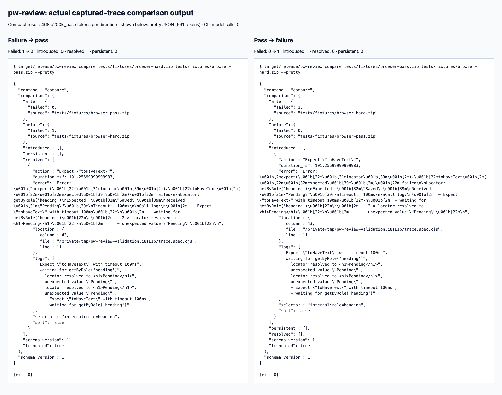

# Rust CLI validation

Validation host: macOS arm64, Rust/Cargo 1.97.0. The repository builds and tests with Cargo only. No Node runtime, browser, API key, or network access is needed for the checked-in integration fixtures.

## Rerunnable checks

```sh
cargo fmt --all -- --check
cargo clippy --locked --all-targets -- -D warnings
cargo test --locked
cargo build --locked --release
```

The final checks pass 62 Rust tests covering parser and report units, CLI contracts, nested GitHub artifacts, and nine captured real traces. The GitHub workflow runs the Cargo gates on Linux and macOS.

## Review regressions

The new regression tests were run against the previous implementation before the fixes. Five tests failed as expected: reused step IDs lost an independent failure; repeated standalone errors lost a failure; two 600-event traces bypassed a 1,000-event artifact budget; compressed trace data bypassed the aggregate decompressed-byte budget; and a retained-detail cap of one produced two items across two traces. A related browser/runner preservation case passed before and after the fixes. Independent review then found that text truncation could alter semantic identity. Two further regression tests failed before moving selector/location truncation to the retained-output boundary, then passed: selector-prefix collisions no longer merge independent failures, and a truncated location no longer duplicates a related runner error. They cover text caps zero, one, and the default, including selectors with a shared prefix longer than the default cap. A further real-fixture regression combined two independent captured recordings with reused step IDs and grouped both browser streams before both runner streams. It reproduced 36 actions instead of 30 because an unrelated completion evicted a candidate still needed later. The fix keeps unmatched candidates by role and consumes only the compatible one.

| Behavior | Rerunnable evidence |
| --- | --- |
| Independent streams sharing step IDs retain both failures | `unrelated_streams_reusing_step_ids_keep_both_failures` |
| Recording directory, origin, timing, and available metadata constrain merges | `cross_stream_steps_need_matching_recording_scope_role_and_time` |
| Related browser/runner steps merge, including clock rounding, soft metadata, and detail cap zero | `related_runner_and_browser_streams_merge_the_same_step` |
| Identical standalone errors remain distinct within and across streams | `repeated_standalone_errors_remain_independent_within_and_across_streams` |
| Interleaved recordings cannot evict unmatched candidates | `interleaved_recordings_keep_unmatched_step_candidates` |
| Text detail limits cannot alter failure identity or copied-error deduplication | `text_caps_do_not_merge_distinct_selector_prefixes`, `text_caps_do_not_duplicate_a_related_action_error` |
| GitHub traces share the event budget | `github_event_budget_is_shared_by_all_nested_traces` |
| Nested compression cannot reset the decompressed-byte budget | `github_decompressed_byte_budget_is_shared_by_all_nested_traces` |
| Detail caps zero/one preserve totals and per-report truncation | `github_retained_failure_budget_preserves_totals_and_truncation` |
| Comparison uses raw identity even with zero/default text caps or merged browser/runner evidence | `cargo test --locked --test comparison_contract` |
| Console records cannot be decoded as action locations, but still consume event budget | `console_and_non_action_records_are_ignored_but_count_toward_limits` |
| Remote clocks produce a normalized duration, including legacy metadata | `cargo test --locked --test duration_contract`, `remote_clock_fixture_has_seconds_not_hours_of_duration` |

The later comparison regressions failed before the fix: different identities collided after truncation, and identical identities stopped matching across different text caps. Raw action/selector/location identities now remain private and are omitted from JSON. Their merge precedence matches retained evidence. This changes Rust struct-literal construction of `Failure`; library consumers obtain failures through `analyze`/`analyze_all`. JSON field names and schema remain unchanged. Console-location regression also failed with `missing field file` before event-type dispatch was moved ahead of action-field decoding. Ignored records still consume byte/event budgets, and malformed JSON remains an error.

Other contracts cover malformed/missing/unsupported inputs, interleaved actions, incomplete actions, legacy formats, UTF-8 truncation, comparison by occurrence, compact JSON, opt-in failure exit codes, output limits, and subprocess cleanup. The GitHub test double serves actual nested ZIP bytes and exercises success, failure, traversal, timeout with a descendant, and cleanup without credentials or network access.

## Targeted mutation checks

A fresh worker copied the `c44af4781bf8298b312e1e4a2a489d46dd381cfa` working-tree implementation into an isolated temporary probe. It changed production code only in that copy. Each targeted regression passed at baseline, failed on an actual behavioral assertion with the injected fault, and passed after restoration. Compilation failures were not counted as kills. The parent independently inspected the assertions and restoration evidence.

| Injected production fault | Observed regression | Result |
| --- | --- | --- |
| Trust a shared step ID without correlation guards | Two independent actions collapse to one | Killed |
| Let standalone errors arm duplicate suppression | Two standalone errors collapse to one | Killed |
| Reset byte usage for each nested trace | Over-budget artifact incorrectly succeeds | Killed |
| Reset event usage for each nested trace | 1,200 events incorrectly fit a 1,000-event cap | Killed |
| Reset retained-failure usage for each nested trace | Cap one retains two items | Killed |
| Skip counting when retention is full | Cap zero loses all six failure totals | Killed |
| Omit truncation when retention is full | Affected reports incorrectly claim untruncated evidence | Killed |
| Flush buffered JSON before reporting an output-limit error | stdout leaks an incomplete JSON prefix | Killed |

All eight selected faults were killed; this is scoped behavioral evidence, not a whole-suite mutation score. The correlation guard challenge was also rerun against the later one-millisecond clock-rounding refinement with baseline/fault/restoration all confirmed. The subsequent raw-identity and unmatched-candidate fixes have separate red-to-green regressions and final Cargo gates; they were not part of the original mutation snapshot. Temporary mutation probes did not edit the live working tree.

## Captured real traces

`cargo test --locked --test real_traces` replays three actual Chromium recordings and six historical Playwright traces. [Fixture provenance](../tests/fixtures/README.md) records capture details, upstream revision, original archive hashes, and minimization. The fixtures retain action/error/clock records and omit screenshots, resources, snapshots, and network records. They contain no executable test source.

| Browser capture | Actions | Observed failures | Soft failures |
| --- | ---: | ---: | ---: |
| Passing click and assertion | 14 | 0 | 0 |
| Failed heading assertion | 15 | 1 | 0 |
| Soft heading failure followed by successful click/assertion | 19 | 1 | 1 |

The assertions check the expected outcome, selectors, error evidence, locations, logs, soft metadata, retained-cap zero, comparison, and bounded CLI JSON. The interleaving case replays two and 64 copies of the real failed trace with independently shifted recording clocks, both browser-first and runner-first orderings, retained caps zero/all, and a parsed-event boundary. They do not merely require parsing to succeed. The six historical captures cover older event formats and remote clock differences; the 1.37 capture keeps its incomplete action rather than inventing a pass.

During this revision, an external temporary Playwright 1.56.1 installation and cached Chromium headless shell 1248 also generated fresh passing, hard-failure, and soft-failure traces. All three outcomes, the six complete upstream archives, and self-comparison passed validation. The first sandboxed attempt was blocked by macOS Chromium MachPort initialization; the authorized unsandboxed rerun succeeded. The temporary generator is not shipped in this Rust-only repository.

The Playwright version matches the local Grafana checkout's pin. Neither Grafana's application suite nor either upstream repository's complete test suite was run. Live GitHub authentication was previously checked, but no available Grafana artifact was found; live artifact download is not established by the local test double.

## Failure versus pass comparison and tokens



The image displays actual `--pretty` stdout from the release binary, not an application mockup. Reproduce it from the repository root:

```sh
target/release/pw-review compare tests/fixtures/browser-hard.zip tests/fixtures/browser-pass.zip --pretty
target/release/pw-review compare tests/fixtures/browser-pass.zip tests/fixtures/browser-hard.zip --pretty
```

| Direction | Failed before → after | Introduced | Resolved | Persistent | Exit with `--fail-on-error` |
| --- | --- | ---: | ---: | ---: | ---: |
| Failure → pass | 1 → 0 | 0 | 1 | 0 | 0 |
| Pass → failure | 0 → 1 | 1 | 0 | 0 | 1 |

Default exit status is zero in both cases. `truncated: true` is preserved because the captured failure has more logs than the retained-log cap; the output is bounded evidence, not a promise of complete details. Exact compact stdout is saved for [failure → pass](evidence/hard-to-pass.json) and [pass → failure](evidence/pass-to-hard.json).

| Output format, either direction | UTF-8 bytes | `o200k_base` tokens |
| --- | ---: | ---: |
| Compact JSON (default) | 1,375 | 468 |
| Pretty JSON | 1,706 | 561 |
| Agent prompt (`--prompt`) | 1,646 | 518 |

Counts include the trailing newline, using `tiktoken 0.14.0` with `get_encoding("o200k_base")` and the length of `encode(stdout)`, measured in an isolated temporary environment. The final binary's six outputs were checked byte-for-byte against the measured samples. Token counts depend on encoding, paths, evidence, and options; these are not asserted to be GPT-6.1 billing counts. The tokenizer is not a repository dependency.

For this fixture pair, the original `.trace` entries contain 18,794 bytes and 5,911 tokens (sum of separately encoded entries). The compact comparison is 92.08% smaller in tokens. This is a lossy evidence summary, not compression of equivalent information; ZIP binaries, snapshots, and images are excluded from that baseline.

The CLI makes no model calls, so its direct model-token usage is **zero**. Sending its output to an agent consumes that agent's context. Actual tokens spent developing/reviewing this PR are not exposed by the session tools and were not measured.

## Boundaries

Single-input analysis and artifact batches share the same parser. Artifact extraction has its own cumulative byte bound; trace parsing additionally counts actual decompressed bytes, including JSON whitespace, across all nested traces. Parsed events and retained failure evidence are also cumulative. Summary failure/soft totals continue after the retained-detail cap, and affected reports are marked truncated. Input or output budget errors never return a fabricated complete report.

Runner/browser correlation uses step ID within an archive directory, opposite recorded stream origins, compatible raw selector/location evidence when both are supplied, and nested action intervals normalized through `wallTime - monotonicTime`. A one-millisecond allowance covers the header's integer wall-clock resolution. Missing or inconsistent cross-stream clocks conservatively leave actions separate. Unmatched completions are queued separately by browser/runner role for each scoped step ID. Matching consumes only its compatible candidate; unrelated candidates cannot evict one another. Each completed action contributes at most one pending candidate, so candidate storage is bounded by the input and event limits. Only opposite-role candidates are scanned; deque removal avoids shifting the remaining queue when the first candidate matches. Matching is not a constant-time guarantee for adversarially reused IDs. Raw selectors and source locations remain internal correlation identity regardless of `--max-text`; truncation applies when building retained failures. Standalone errors cannot arm the duplicate-action-error suppression state, and stream boundaries clear that state.

Summary duration spans action timestamps normalized with each stream's `wallTime - monotonicTime` offset, including legacy action metadata. The captured remote-clock fixture previously reported 57,978,221.456 ms; it now reports approximately 7,844.123 ms. Its regression and three clock-boundary tests failed before the fix and pass after it. Raw timestamps from streams without a usable anchor remain in a separate span; they are never compared directly against epoch timestamps. If both domains exist, the larger of their spans is reported because their relative placement cannot be established. Fully unanchored inputs retain the previous raw-span behavior. Header wall clocks still need to be accurate for cross-host wall-time comparisons; missing anchors cannot establish cross-host elapsed time. Non-finite normalized timestamps or durations are rejected. Screenshot and DOM interpretation remain the job of Playwright Trace Viewer or a separate visual agent.

Rust received a manual lazy-clean pass plus rustfmt and Clippy. No JavaScript/TypeScript remains for the language-specific checker to inspect. The crate forbids authored unsafe code and uses no async runtime, HTTP client, provider SDK, database, or daemon.
